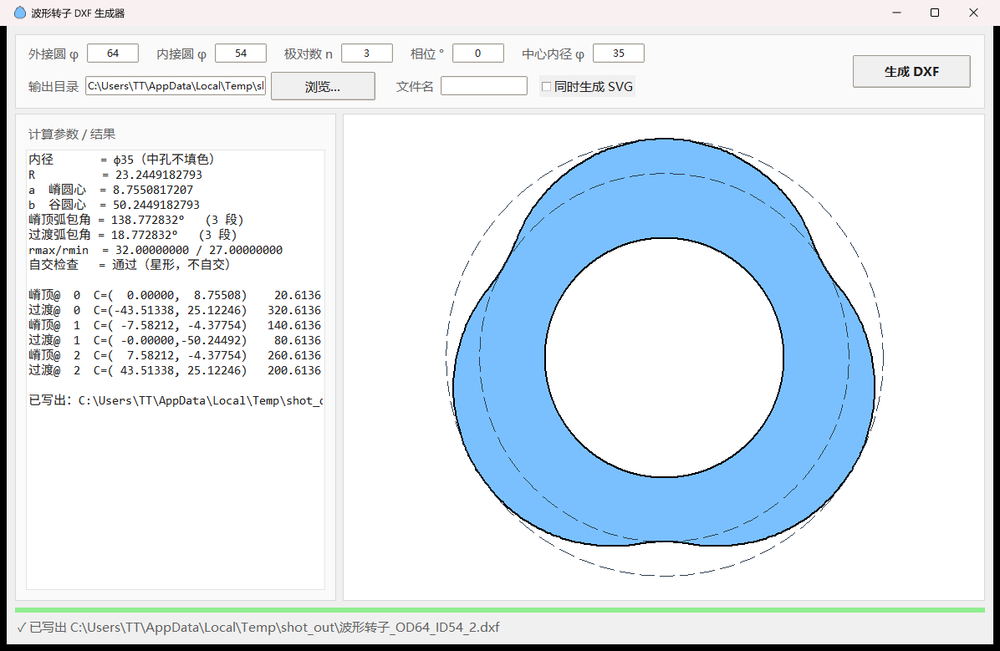
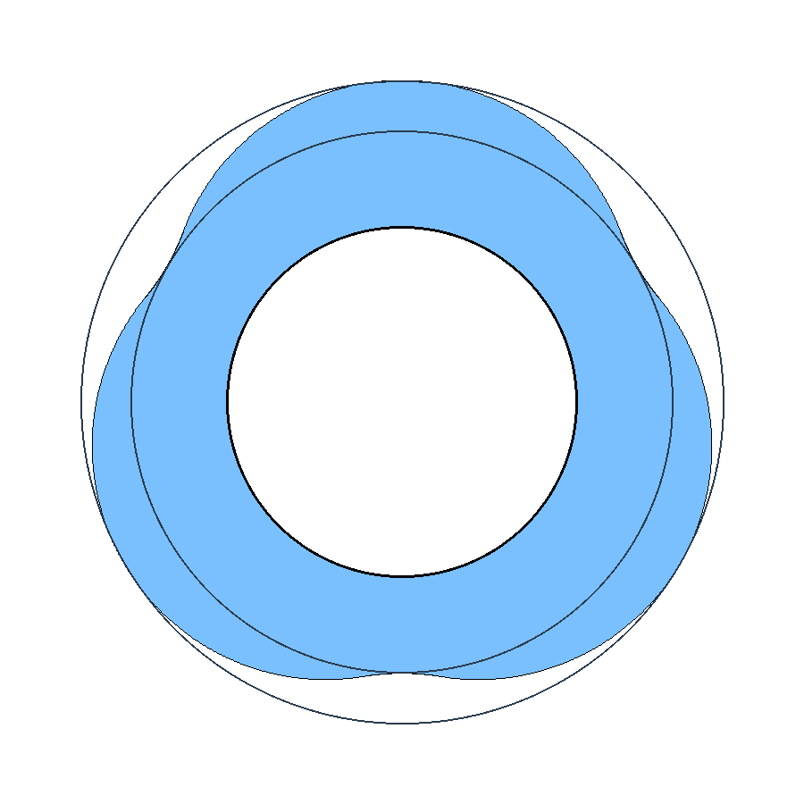

# 波形转子轮廓生成器 v2.0

把「外接圆 / 内接圆 / 极对数（可选中心内径）」几个数，直接变成可直接进 CAD 的转子轮廓 DXF。

作者：**[novelistMYC](https://github.com/novelistMYC)**

---

<p align="center">
  
</p>

<p align="center">
  <b>界面（v2）</b>：顶栏是标题与主操作（打开输出目录 / 生成 DXF）；左栏填参数与输出；<br>
  右侧大画布**随参数改动即时重绘**，下方一条指标栏，需要时再展开每段弧明细表。
</p>

<p align="center">
  
</p>

<p align="center">
  <b>输出示例</b>：外接圆 φ64 · 内接圆 φ54 · 中心内径 φ35 · 3 对极 · 相位 0°<br>
  （粗线为波形轮廓，细线圆为内外接圆辅助线，中心为不填色的通孔）
</p>

---

## 工程目的

有一类转子的外轮廓不是正圆，而是沿着圆周起伏的“波”：**几对极就是几个周期**，
波峰贴外接圆、波谷贴内接圆。这种轮廓在 CAD 里用约束画很别扭——外接圆和内接圆是给定的，
但中间那 2n 段圆弧该取多大半径、圆心放在哪，只能靠试凑，稍有偏差切点就会“开缝”。

本工具把这件事归结为**一次一元二次方程的解析求解**：输入几个数，直接输出高精度 DXF，
不需要任何迭代、不需要约束求解器，也没有累积误差。

## 原理

### 1. 轮廓的构成

- **n 段凸的「嵴顶弧」**：顶点落在外接圆 r₁ 上；
- **n 段凹的「过渡弧」**：谷底落在内接圆 r₂ 上；
- 共 **2n 段**，**半径完全相同**，且相邻两段相切（G1 连续）。

### 2. 两段弧的圆心

- 嵴顶弧圆心在「嵴轴」上，距中心 **a = r₁ − R**；
- 过渡弧圆心在「谷轴」上，距中心 **b = r₂ + R**；
- 嵴轴与相邻谷轴的夹角 **θ = π / n**。

### 3. 相切条件 ⟹ 求公共半径 R

两段弧半径相同、曲率方向相反，若要相切就只能是**外切**，即两圆心距等于 **2R**。
由余弦定理：

$$
(r_1-R)^2 + (r_2+R)^2 - 2(r_1-R)(r_2+R)\cos\theta = (2R)^2
$$

整理成 R 的一元二次（半角形式）：

$$
R^2 + \cot^2\frac{\theta}{2}\,(r_1-r_2)\,R
- \left[\frac{(r_1-r_2)^2}{4\sin^2\frac{\theta}{2}} + r_1 r_2\right] = 0
$$

取正根即公共半径：

$$
R = \frac{-\cot^2\frac{\theta}{2}(r_1-r_2)
+ \sqrt{\cot^4\frac{\theta}{2}(r_1-r_2)^2
+ 4\left(\frac{(r_1-r_2)^2}{4\sin^2\frac{\theta}{2}} + r_1 r_2\right)}}{2}
$$

### 4. 其余几何都是闭式解

R 一旦解出，**切点就是相邻两圆心的中点**（等半径外切的必然结果），
再由圆心与切点反算每段弧的起止角即可。全过程没有任何迭代或拟合。

### 5. 两条互不顶替的校验

- **星形域判据**：对 2n 段弧采样，看轮廓的**极角是否单调**。
  不单调 ⇒ 轮廓有**局部倒扣**（深波形），**但这不等于自交**。
- **自交检测**：把轮廓采样成折线后**逐段求交**（均匀网格粗筛，大 n 也不慢），
  只有真的检出交点才报「轮廓自交」。
- 另对「嵴顶弧包角 > 180°」「过渡弧包角 < 3°」这类工艺上需要注意的形态给出提示。

> v1 把「极角不单调」直接当成「自交」，实测会误报；v2 把两者拆开（详见下面的改动表）。

## 参数

| 参数 | 含义 | 说明 |
| --- | --- | --- |
| 外接圆 φ | 轮廓最大处（波峰）所在圆 | 必填 |
| 内接圆 φ | 轮廓最小处（波谷）所在圆 | 必填，须小于外接圆 |
| 极对数 n | 波的数量（几对极） | 必填，≥ 2 |
| 相位 ° | 整体旋转角 | 默认 **0 = 极顶朝正上**（左右对称），逆时针为正 |
| 中心内径 φ | 转子中央的通孔 | 可选，**不参与填充**，必须小于内接圆 |

## 用法

程序是**纯标准库 Python 3**，没有第三方依赖。

```bash
# 图形界面（双击 exe 即为此模式）
py 转子波形DXF生成器_v2.py --gui

# 交互式问答
py 转子波形DXF生成器_v2.py

# 一行命令
py 转子波形DXF生成器_v2.py -o 64 -i 54 -n 3 --phase 0 --bore 20

# 版本号
py 转子波形DXF生成器_v2.py --version
```

也可以用 PyInstaller 打包成免安装的单文件 exe：

```bash
py -m PyInstaller --onefile --windowed --name 波形转子生成器_v2 \
    --icon 波形转子.ico --add-data "波形转子.ico;." 转子波形DXF生成器_v2.py
```

## 安装包（分发给使用者）

给对方用，发这一个文件就够：**`波形转子DXF生成器_安装包_v2.0.exe`**（约 12 MB）。

**下载**：到 [Releases](https://github.com/novelistMYC/wave-rotor-profile-generator/releases/latest) 页下载 `波形转子DXF生成器_安装包_v2.0.exe`。

1. 双击 → 中文向导，三步到底（欢迎 → 选目录 → 安装）；
2. 装完**桌面自动出现**「波形转子 DXF 生成器」快捷方式，开始菜单里也有（程序 / 使用说明 / 卸载）；
3. 按**当前用户**安装到 `%LOCALAPPDATA%\Programs\波形转子DXF生成器`，不需要管理员权限、不会弹 UAC；
4. 卸载走「设置 → 应用」，或在开始菜单里点卸载——目录、快捷方式、注册表项都会清干净。

> 安装包没有代码签名，首次运行 Windows 会提示「已保护你的电脑」：点「更多信息」→「仍要运行」，只需一次。
>
> 要求：**64 位 Windows 10 / 11**（程序用 Python 3.13 打包，Win7 与 32 位系统跑不了）。

安装包配置就在仓库里：`安装包/wave_rotor_v2.iss`，改了程序后重新出包：

```bat
ISCC.exe 安装包\wave_rotor_v2.iss
```

## 输出

**DXF（R12，坐标保留 10 位小数）**：

| 图层 | 内容 |
| --- | --- |
| `WAVE` | 2n 段圆弧（首尾相切构成完整轮廓）+ 中心内径通孔（选填） |
| `AUX` | 内外接圆辅助线（**该图层默认关闭**：颜色码取负值＝图层 Off，图元与图层都保留，在 CAD 里打开图层即显示） |

只有这两个图层，**没有空图层**——原来的 `0`（空图层）与 `BORE`（中心孔，已并入 `WAVE`）都已去掉。
图层名保持英文、文件为纯 ASCII，发给任何语言环境的客户都不会乱码。

可选同时输出一份 SVG 预览。输出文件**永不覆盖**：同名时自动追加 `_2`、`_3`。

## 界面

浅灰底 + 白色卡片 + 单一强调蓝的现代界面，三块内容一眼分清：

- **顶栏**：标题 + 「打开输出目录」「生成 DXF」（主按钮为实心蓝）；
- **左栏**：参数（外接圆 / 内接圆 / 极对数 / 相位 / 中心内径）与输出（目录、文件名、SVG 开关）；
- **右侧**：大画布预览 + 两枚状态徽章（星形域 / 自交）+ 底部指标栏（R、a、b、两个包角、实测 rmax/rmin）；
  点「明细」可展开每段弧的圆心与起止角表格；
- **底栏**：状态点（绿/橙/红）+ 提示 + 版本号。

交互细节：

- 改任一参数 → **立即重算重绘**（120 ms 防抖），不必先点生成；
- 参数不合法 → 预览区顶部红色提示条 + 画布中央写出原因，指标归零；
- 检出真实自交 → 徽章转红、提示条变红、底栏状态点变红；
- 生成成功后，完整输出路径显示在底栏；同名文件自动追加 `_2`、`_3`。

**高分屏**：启动时先声明 DPI 感知（`SetProcessDpiAwareness`），界面按显示器的真实 DPI 渲染——
200% / 150% 缩放下**不再被系统把 96 DPI 的位图整幅放大**（那是上一版发虚、发糊、有颗粒的根因）；
所有间距、控件尺寸、画布边距都按 DPI 等比换算，字号以 **11pt** 为基准（上一版是 9pt）。

## v2.0 相对 v1 的改动

| # | v1 的问题 | v2 的做法 | 验证 |
| --- | --- | --- | --- |
| 1 | 「自交检查」其实只查极角单调，README 却写「不单调即自交」 | 拆成**星形域判据**与**真·自交检测**两条独立结论，措辞同步更正 | 190 组参数（外径 100、内径 5~94、n=2~20）扫描：v1 判 113 组「不通过」，其中 **62 组几何上并不自交**（均为嵴顶弧 >180° 的深波形）；v2 的判定与独立逐段求交结果一致，**误报 0、漏报 0** |
| 2 | 判据不通过时「总转角」恒显示 `0.000000°` | 总转角按整圈累计，判据失败也给真实值 | 非星形域的 φ200/φ20/3 对极：显示 360.000000° |
| 3 | 界面并不实时：改参数要拉伸窗口或点生成才刷新 | 5 个输入框全部挂 `StringVar` 监听 + 120 ms 防抖 | 初始画面与改动后走的是同一个 `refresh()` 路径 |
| 4 | 结果全挤在一条等宽文本里，输出路径过长被截断 | 结果改为底部指标栏 + 可展开的每段弧表格；完整路径移到顶栏与底栏 | — |
| 5 | 缺少「打开输出目录」 | 顶栏新增按钮 | — |
| 6 | 告警里的 `⚠` 在重定向到 GBK 控制台时会抛 `UnicodeEncodeError` | 启动时把 stdout/stderr 设为 `errors="replace"` | 重定向到文件不再崩 |
| 7 | 200% 缩放下整个界面发虚、有颗粒感，字也偏小 | 启动声明 DPI 感知，尺寸随 DPI 等比缩放，字号基准 9pt → 11pt | 192 DPI 下截图逐像素清晰（见 `docs/screenshot.png`） |

**兼容性**：几何算法与 DXF/SVG 输出格式**完全没动**——同一组参数，v2 与 v1 生成的
`.dxf`/`.svg` **逐字节一致**（已抽样 7 组参数、含相位/内径/大 n 情形比对 sha256）。
所以 v2 可以直接替换 v1 使用，已有图纸不需要重出。

## 许可

MIT License
